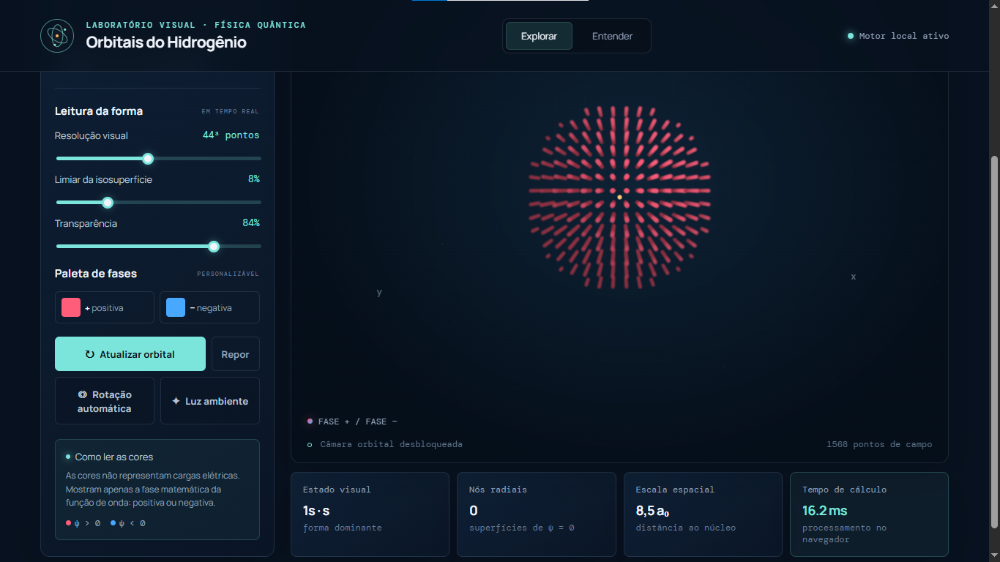
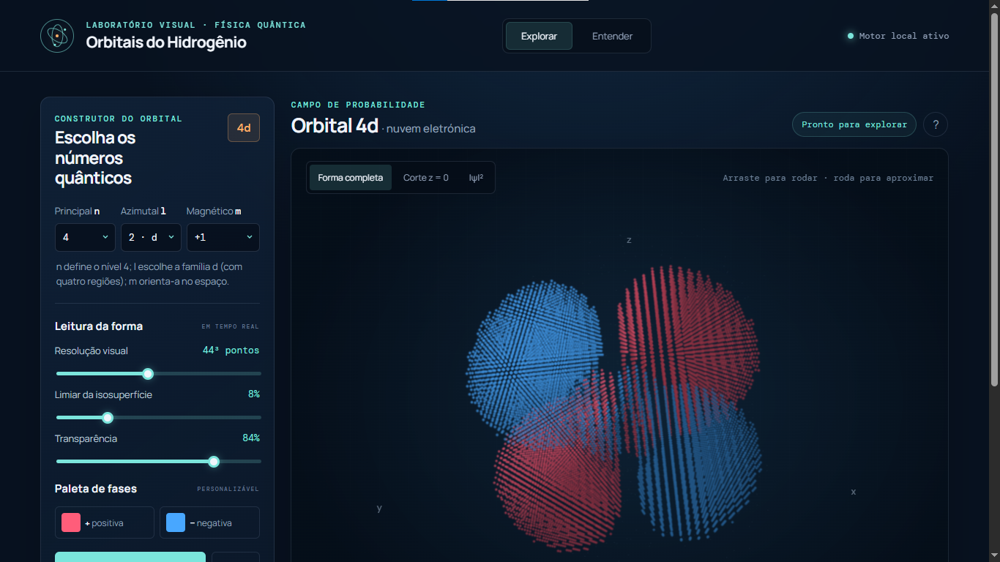
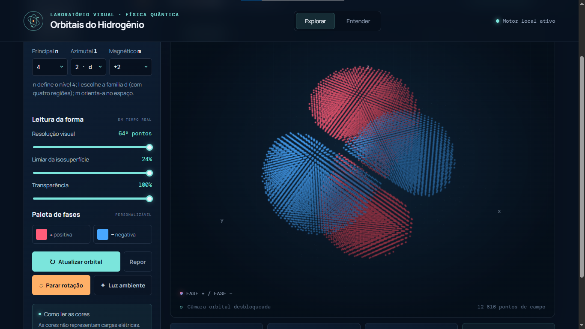
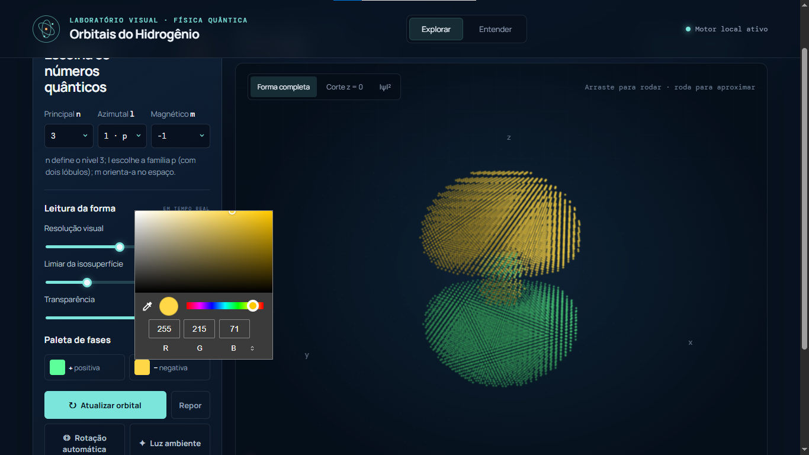
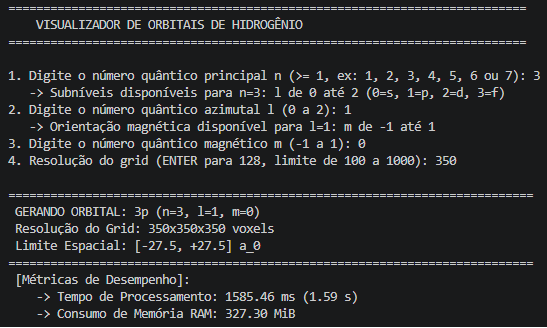
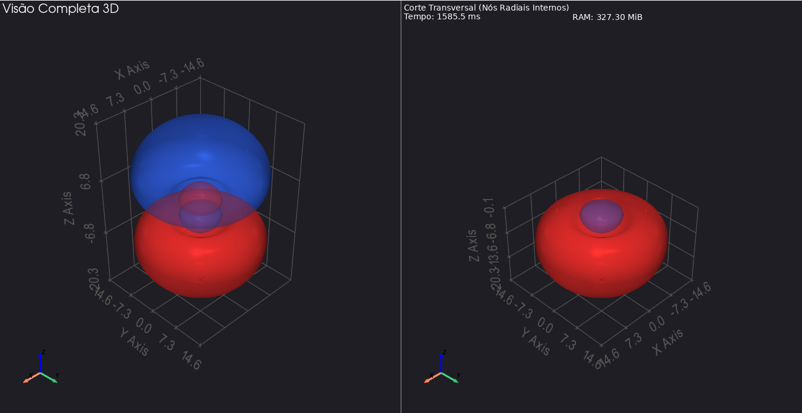
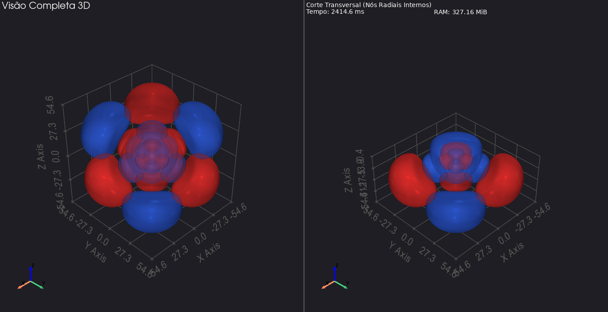

<div align="center">

# Orbitais do Hidrogênio · Explorador 3D

**Visualização interativa em 3D e simulação computacional da função de onda $\psi_{n,l,m}(r, \theta, \phi)$ e densidade de probabilidade $\vert{}\psi\vert{}^2$ do átomo de hidrogênio.**


</div>

---

## Sobre o Projeto

O **Orbitais do Hidrogênio · Explorador 3D** é uma ferramenta didática projetada para transformar equações abstratas da mecânica quântica em representações visuais intuitivas e manipuláveis em tempo real. 

O repositório conta com **duas abordagens complementares**:
1. **Versão Web (`index.html`):** Aplicação autocontida construída com **Three.js (WebGL)**, rodando diretamente no navegador com renderização volumétrica/nuvem de pontos, controle de câmera orbital e troca instantânea de estados quânticos.
2. **Versão Python (`vizualizador_hidrogenis.py`):** Script científico para geração de malhas isosuperfície 3D, cortes transversais e análise numérica das funções de onda em ambiente desktop.

---

## Demonstração Visual

### 1. Versão Web Interativa (`index.html`)

A interface web permite explorar os orbitais diretamente no navegador com renderização volumétrica em tempo real, controles de resolução e personalização de cores.

#### Página Inicial · Orbital Fundamental ($1s$)

> Visualização do estado fundamental ($n=1, l=0, m=0$) com métricas de nós radiais, escala espacial em raios de Bohr ($a_0$) e tempo de processamento no navegador.

<br>

#### Exploração de Orbitais Complexos ($4d, m=+1$)

> Representação da nuvem eletrônica com quatro lóbulos, distinguindo visualmente as fases positiva (vermelho) e negativa (azul) da função de onda.

<br>

#### Controle de Resolução e Limiar ($4d, m=+2$)

> Aumento da densidade de pontos ($64^3$) e ajuste do limiar de isosuperfície para evidenciar a geometria interna dos lóbulos.

<br>

#### Personalização de Fases e Cores ($3p, m=-1$)

> Seletor RGB em tempo real para alterar as cores das fases da função de onda e controles de rotação automática da câmera.

---

### 2. Versão Científica em Python (`vizualizador_hidrogenis.py`)

O script em Python foca na geração de malhas de alta resolução (algoritmo *Marching Cubes*) e na análise interna da estrutura dos orbitais, exibindo métricas de desempenho no terminal.

#### Entrada de Parâmetros e Benchmarking no Terminal

> O usuário informa os números quânticos ($n, l, m$) e a resolução da grade tridimensional (ex.: $350 \times 350 \times 350$ voxels). Ao final do cálculo, o sistema exibe o tempo exato de processamento e o consumo de memória RAM.

<br>

#### Orbital $3p$ ($n=3, l=1, m=0$) — Visão Completa e Corte Transversal

> À esquerda, a superfície 3D completa; à direita, o corte seccional revelando os **nós radiais internos** (regiões onde a densidade de probabilidade é nula).

<br>

#### Orbital de Alta Ordem — Simetria Multilobular

> Renderização de alta definição demonstrando a complexidade geométrica, o corte transversal e as inversões de fase em níveis energéticos superiores.

---

## Funcionalidades Principais

- **Visualização 3D em Tempo Real:** Rotação livre ($360^\circ$), zoom e panorâmica para inspecionar simetrias esféricas, halteres ($p$), trevos ($d$) e geometrias complexas ($f$).
- **Seleção de Números Quânticos:** Explore diferentes combinações de:
  - **Número Quântico Principal ($n$):** Nível de energia e tamanho radial ($n = 1, 2, 3, 4...$).
  - **Número Quântico Azimutal ($l$):** Subnível e formato do orbital ($s, p, d, f$, onde $0 \le l < n$).
  - **Número Quântico Magnético ($m_l$):** Orientação espacial no eixo cartesiano ($-l \le m_l \le +l$).
- **Codificação por Fase ou Densidade:** Distinção visual entre regiões de fase positiva ($+$) e negativa ($-$) da função de onda, além dos planos/superfícies nodais onde $\vert{}\psi\vert{}^2 = 0$.
- **Zero Dependências na Web:** O arquivo `index.html` já inclui o motor **Three.js** embutido — basta abrir no navegador ou hospedar no **GitHub Pages**.

---

## 📂 Estrutura do Repositório

```text
├── Imagens/                         # Capturas de tela das versões Web e Python
├── index.html                       # Aplicação Web 3D interativa (Three.js embutido)
├── vizualizador_hidrogenis.py       # Versão Python para simulação e plotagem científica
├── Projeto_ComputaçãoGráfica.pdf    # Artigo sobre o tema
└── README.md                        # Documentação do projeto
```

---

## Controles 3D

| Ação | Mouse (Desktop) | Touch (Mobile/Tablet) |
| :--- | :--- | :--- |
| **Rotacionar** | Clique esquerdo + Arrastar | Arrastar com 1 dedo |
| **Zoom** | Roda de rolagem (*Scroll*) | Movimento de pinça |
| **Mover (Pan)** | Clique direito + Arrastar | Arrastar com 2 dedos |

---

## Equação Base

A distribuição espacial do elétron é calculada a partir das soluções da Equação de Schrödinger independente do tempo em coordenadas esféricas:

$$\psi_{n,l,m}(r, \theta, \phi) = R_{n,l}(r) \cdot Y_l^m(\theta, \phi)$$

- **$R_{n,l}(r)$:** Componente radial (Polinômios Associados de Laguerre).
- **$Y_l^m(\theta, \phi)$:** Componente angular (Harmônicos Esféricos).

---

## Como Executar

### 1. Clonar o Repositório
```bash
git clone [https://github.com/CarolineGrizante/hidrogenio_subniveis_energeticos_3d.git](https://github.com/CarolineGrizante/hidrogenio_subniveis_energeticos_3d.git)
cd hidrogenio_subniveis_energeticos_3d
```

### 2. Versão Web (`index.html`)
Não exige instalação de dependências ou servidor local. Basta dar um duplo clique no arquivo `index.html` para abri-lo em qualquer navegador moderno (Chrome, Edge, Firefox ou Safari).

### 3. Versão Python (`vizualizador_hidrogenis.py`)
1. Instale as bibliotecas necessárias:
   ```bash
   pip install numpy scipy pyvista
   ```
   *(Caso utilize um arquivo `requirements.txt`, rode `pip install -r requirements.txt`)*

2. Execute o script:
   ```bash
   python vizualizador_hidrogenis.py
   ```
